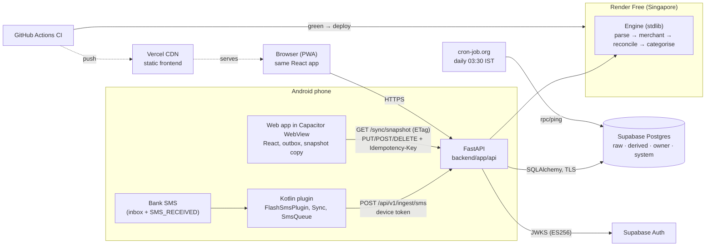
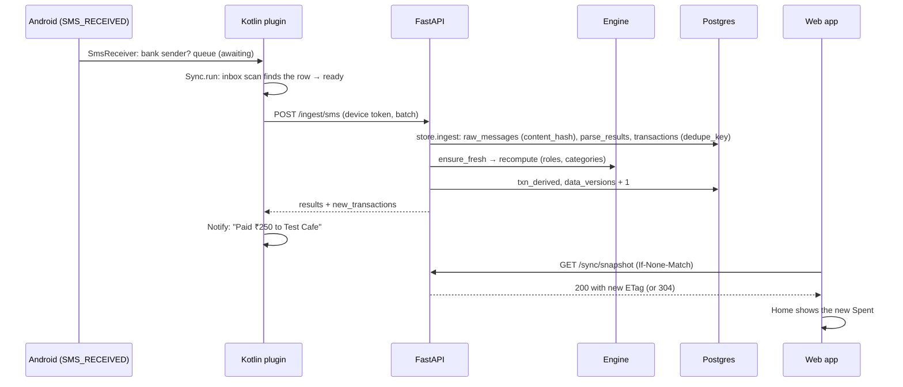

# Flash Expense Tracker, explained

A technical walk-through for someone who has never seen the project: what it does, how the
pieces fit, which file controls what, and why it was built this way. File paths are
relative to the repository root; `D-nnn` numbers point to [docs/DECISIONS.md](docs/DECISIONS.md).
State: end of Phase 5 (28 Nov 2026). Commands are in [docs/operations.md](docs/operations.md).

Contents: 1 The idea · 2 System overview · 3 Folder map · 4 Which file controls what · 5 The
life of one payment · 6 How the database moves · 7 The owner's answers · 8 Auth and security ·
9 Android in depth · 10 Infrastructure and cost · 11 Testing · 12 Major decisions · 13 Known
limits and Phase 6 · 14 Glossary

---

## 1. The idea

**The problem.** Indian banks send an SMS for every card payment, UPI transfer and ATM
withdrawal. Those messages are the most complete record of where money goes, but they are
unreadable as a whole: hundreds a month, half of them about money moving between your own
accounts or friends paying you back. Students and people in their first job, who split
bills constantly, cannot tell from them how much they actually spent.

**What Flash does.** It reads only the bank SMS, turns each into a transaction, works out
what each one *is* (spending, a refund, a friend paying you back, income, a transfer between
your own accounts, a duplicate message), puts spending into categories, and shows a monthly
picture: **Spent**, **Paid back**, **Net** (Spent minus Paid back), **Invested**, and what
still needs your decision. No manual entry, no bank login.

**For whom.** Students and first-job earners in India; the owner first, then a few invited
testers (D-128).

**Principles.**

- **Privacy first.** Only bank SMS leave the phone; OTPs, promotions and personal messages
  never do (D-049, D-123). Nobody but you sees your data; the admin sees counts only
  (D-147). Real data never enters git or AI tools (D-008, D-015, D-048).
- **No lending, no ads, no credit scoring** ([docs/privacy.md](docs/privacy.md)).
- **Running cost ₹0**: free plans only (D-006), no paid services.
- **Owner data wins.** What you answer is stored separately from what the engine works
  out, survives every re-run of the engine, and always takes precedence (D-059, D-065).
- **A guess never lowers Net.** Only an answer you gave can take money out of Spent or
  count a credit as paid back (D-076, D-133, D-156).
- **Money is exact**: integer paise, never floats (D-001); stored in UTC, shown in IST
  (D-002).

## 2. System overview

- The **phone** has two halves: a native Kotlin plugin that reads bank SMS and uploads them
  with an ingest-only device token, and the web app (the same React code as the website)
  inside Capacitor's WebView, which talks to the API with the user's Supabase login.
- The **API** (FastAPI on Render) checks every request's login or device token, stores
  messages, runs the engine and serves one read model, the **snapshot** (D-088).
- The **engine** (`backend/app/engine/`) is plain Python with no framework or database code
  (D-043): parsers, merchant normalisation, reconcile (roles and links), categorise.
- **Postgres** (Supabase) holds raw messages, the derived results, the owner's answers and
  system tables; **Supabase Auth** holds logins.
- **Vercel** serves the website; **cron-job.org** keeps the free database from pausing
  (D-053); **GitHub Actions** gates Render's deploys (D-050).

## 3. Folder-by-folder map

| Folder | What lives there |
| --- | --- |
| `backend/` | The API, engine, CLI and their tests. Render's root (`infra/render.yaml`). |
| `backend/app/api/` | HTTP routes: `v1.py` (summary, transactions, answers), `snapshot.py`, `devices.py` (phones and ingest), `users.py` (sign-up, invites, members, delete account), `analytics.py`, `export.py`, `auth.py`, `ops.py` (the write path), `health.py`, `supabase_admin.py`. |
| `backend/app/engine/` | The pure engine: `parsers/` (`hdfc.py`, `sbi.py`, `generic.py`, `base.py`), `senders.py` (bank sender registry), `filters.py` (OTP and promo rules), `merchant.py` + `brands.json`, `reconcile.py`, `credits.py`, `categorise.py` + `category_words.py`, `suggest.py`, `statement_hdfc.py`, `statement_check.py`, `money.py`, `timeparse.py`. |
| `backend/app/pipeline/` | Engine to database: `store.py` (ingest), `dedupe.py`, `reparse.py`, `recompute.py`, `owner_actions.py` (every owner write), `owner_load.py`, `version.py` (data version), `export.py`, `doctor.py`, `review.py`, `statement.py`, `survey.py`, `account.py` (Delete my account), `payback_audit.py`, `sample_export.py`. |
| `backend/app/importers/` | `sms_backup.py`: SMS Backup & Restore XML, streamed. |
| `backend/app/` (files) | `main.py` (app, CORS, gzip, body limit), `models.py` (every table), `db.py`, `config.py`, `cli.py` (owner commands), `requestlog.py`. |
| `backend/alembic/versions/` | Migrations `0001` to `0019` (no `0011`). |
| `backend/tests/` | pytest, FAKE data only; `fixtures/` (SMS, statements, payee name tables, owner file), `cross_origin_server.py` (the API for the browser harnesses). |
| `frontend/` | The React + Vite + TypeScript + Tailwind app (website and the Android app's web part). Vercel's root. |
| `frontend/src/` | `App.tsx` (shell, tabs, start-up), `view.ts` (URL routing), `state.tsx`, `ui.tsx`, `back.ts`, `opener.ts` + `provisional.ts` (notification taps), `auth.ts`, `boot.ts`, `pwa.ts`/`update.ts`. |
| `frontend/src/api/` | `client.ts` (the `Api` interface), `http.ts` (the real adapter), `fake.ts` (demo data), `headers.ts` (the shared CORS header list), `types.ts`. |
| `frontend/src/data/` | `store.ts` (snapshot, refresh, ETag), `local.ts` (IndexedDB copy), `outbox.ts` (owner writes). |
| `frontend/src/screens/` | One file per screen: `Home`, `Transactions`, `Insights` (+ `Analytics`), `Todo`, `Labels`, `People`, `BankSms`, `Account`, `Speed`, `Sync`, `Login`; `derive.ts`/`common.ts` (pure helpers). |
| `frontend/src/native/` | `sms.ts` (the bridge to the Kotlin plugin), `smsState.ts` (pure status logic). |
| `frontend/scripts/` | `android.mjs` (APK build), `cross-origin-check.mjs`, `perf-check.mjs`, `screens.mjs` + `screens-page.mjs`. |
| `mobile/android/` | The Capacitor Android project; Kotlin in `app/src/main/java/app/flashexpense/android/`, JVM tests in `app/src/test/`. |
| `scripts/` | Standalone tools: `redact_sms.py` (default-deny redaction), `shape_survey.py`, `parse_coverage.py`, `backup_db.ps1`, `register_backup_task.ps1`, the commit hook test. |
| `infra/` | `render.yaml` (reference copy of the Render service) and the hosting guide. |
| `docs/` | Decisions, API, data model, engine, privacy, UI spec, operations, To-do logic, phase design notes, retro, bank templates. |
| `data/` | Ignored by git except its README; the redacted sample when the owner makes one. |
| `.github/workflows/ci.yml` | CI: backend (ruff, pytest on SQLite), backend on Postgres 17 (migrations, `alembic check`, pytest), frontend (lint, typecheck, tests, build). |
| `.githooks/commit-msg` | Rejects AI attribution lines (D-109). |

## 4. Which file controls what

### Phone (Kotlin, `mobile/android/app/src/main/java/app/flashexpense/android/`)

| Behaviour | File | Notes |
| --- | --- | --- |
| Hearing a new SMS | `SmsReceiver.kt` | Manifest receiver for `SMS_RECEIVED` (permission `BROADCAST_SMS`); bank senders only (`SenderRules.kt`); queues it and asks for an upload at once. |
| Which senders are banks | `SenderRules.kt` | Reads the same sender list as the server (D-123). |
| Inbox scan and cursor | `Inbox.kt`, `Store.kt` | Pages the SMS inbox by `(date, _id)` after the cursor, rescanning the last 10 minutes (`Wire.OVERLAP_MS`). |
| Upload queue | `SmsQueue.kt` | SQLite tables `ready`, `awaiting` (live copies waiting for their inbox row), `seen`, `events` (last 100). |
| Upload and retries | `Sync.kt` | `Sync.run`; `Work.upload` (expedited one-off work, exponential backoff from 30 s, replaces a waiting retry) and `Work.catchUp` (hourly periodic); connect 15 s, read 90 s. |
| Request body, answers, limits | `Wire.kt` | JSON batch (≤ 500), what each status means (split, drop one, retry, stop), `normalBody`, the notification item JSON. |
| Device token storage | `Store.kt` | Sealed with an AES-GCM key in the Android Keystore; never returned to the web app. |
| Payment notifications | `Notify.kt` | Channel "payments", one per payment or grouped, "Change category" action, the payment's basics in the tap intent (D-142, D-153). |
| Bridge to the web app | `FlashSmsPlugin.kt` | Status, permission, connect/disconnect, history scan, Sync now, diagnostics, share file, notification taps, the back button switch (D-154). |
| The Activity | `MainActivity.kt` | Capacitor's `BridgeActivity`, registers the plugin. |
| Sharing an export | `AndroidManifest.xml`, `res/xml/file_paths.xml` | A FileProvider exposing only `cache/exports/`. |

### Frontend (`frontend/src/`)

| Behaviour | File |
| --- | --- |
| Routing: everything on screen is in the URL hash | `view.ts` (`parseHash`, `toHash`, `parentOf`), `state.tsx` (`navigate`, `useNav`) |
| Snapshot, refresh every 60 s and on focus, ETag/304 | `data/store.ts` (`startData`, `refresh`, `pull`) |
| The phone's copy of the snapshot | `data/local.ts` (IndexedDB database `flash`) |
| Owner writes: saved first, sent with Idempotency-Key, never stuck | `data/outbox.ts` (`enqueue`, `drain`, `actions`) |
| HTTP, 401 refresh once, errors | `api/http.ts`; the header list shared with CORS: `api/headers.ts` |
| Login | `auth.ts` (Supabase JS client) |
| Boot without the network | `boot.ts`, `App.tsx` |
| Notification taps | `opener.ts`, `provisional.ts` |
| Android back button | `back.ts` (rules), `App.tsx` (`useBackButton`), `ui.tsx` (`Sheet` registers) |
| Bank SMS on the phone | `native/sms.ts`, `native/smsState.ts`, `screens/BankSms.tsx` |
| Screens | `screens/*.tsx`; money and dates formatting: `lib/money.ts` (Indian grouping), `lib/dates.ts` (IST) |
| Update bar (website only) | `update.ts`, `pwa.ts` |

### Backend (`backend/app/`)

| Behaviour | File |
| --- | --- |
| App, CORS (exact header list), gzip, 8 MB body limit | `main.py` |
| Login token check (Supabase JWKS, ES256), roles | `api/auth.py` (`current_user`, `require_admin`) |
| Phones: register, list, revoke; SMS ingest | `api/devices.py` |
| Every owner write: Idempotency-Key, lock, recompute mark, data version | `api/ops.py` (`write`) |
| Answers, summary, transactions, labels, people, rules, per-credit answers | `api/v1.py` → `pipeline/owner_actions.py` |
| Snapshot and its cheap ETag | `api/snapshot.py` (`build`, `cheap_etag`) |
| Analytics | `api/analytics.py` |
| Export (CSV, Excel) | `api/export.py`, `pipeline/export.py` |
| Sign-up, invites, members, Delete my account, rate limits | `api/users.py`, `pipeline/account.py`, `api/supabase_admin.py` |
| Storing a message, dedupe, live/inbox join | `pipeline/store.py` (`ingest`, `twin`, `emoji_twin`), `pipeline/dedupe.py` |
| Re-reading messages with a newer parser | `pipeline/reparse.py` |
| Recomputing roles, links, categories | `pipeline/recompute.py` |
| Data version (the ETag's source) | `pipeline/version.py` |
| Owner commands | `cli.py` (`COMMANDS`) |
| Request log (route template only) | `requestlog.py` |

### Engine stages (`backend/app/engine/`)

| Stage | File | Version |
| --- | --- | --- |
| Bank sender registry, normalised sender codes | `senders.py` | (data) |
| OTP, promotion and notice filters | `filters.py` | (data) |
| HDFC templates | `parsers/hdfc.py` (templates in [docs/templates/hdfc.md](docs/templates/hdfc.md)) | `hdfc-1.2.0` |
| SBI templates | `parsers/sbi.py` ([docs/templates/sbi.md](docs/templates/sbi.md)) | `sbi-1.0.0` |
| Other banks, carefully | `parsers/generic.py` (D-101) | `generic-1.0.0` |
| Merchant key, display name, person or business | `merchant.py`, `brands.json` (D-057, D-058) | `merchant-1.1.1` |
| Roles and links | `reconcile.py` (D-059 to D-062, D-115, D-134, D-145) | `reconcile-1.7.1` |
| Credits: senders, payback links, masked UPI IDs | `credits.py` | (part of reconcile) |
| Categories | `categorise.py` + `category_words.py` (D-073, D-119, D-133, D-155) | `categorise-1.4.0` |
| "Is this you?", "Is this an investment?" | `suggest.py` (D-117, D-118) | |
| HDFC statement reader and statement check | `statement_hdfc.py`, `statement_check.py` (D-114, D-120) | `stmt-hdfc-1.1.0` |

Details of every rule: [docs/engine.md](docs/engine.md).

### Elsewhere

| What | Where |
| --- | --- |
| Owner CLI commands | `backend/app/cli.py`; how to run them: [docs/operations.md](docs/operations.md) |
| Migrations | `backend/alembic/versions/` |
| CI | `.github/workflows/ci.yml` |
| Render settings | `infra/render.yaml` |
| Backups | `scripts/backup_db.ps1`, `scripts/register_backup_task.ps1` (D-084, D-157) |
| Redaction of samples | `scripts/redact_sms.py`, `scripts/keep_names.txt` (D-014, D-016) |

## 5. The life of one payment

You pay ₹250 by UPI to a café. HDFC sends "Sent Rs.250.00 From HDFC Bank A/C *0001 To
TEST CAFE ... Ref 6123..." (FAKE).

1. **Heard on the phone.** `SmsReceiver.kt` gets `SMS_RECEIVED`. If the sender is a bank
   (`SenderRules.kt`) and the phone is connected, the message goes to the `awaiting` table
   of `SmsQueue.kt` and `Work.upload(context, "live")` starts at once (expedited work on
   Android 12+, replacing any retry waiting in backoff, D-142).
2. **Matched with the inbox.** `Sync.run` scans the SMS inbox after the cursor
   (`Inbox.page`), moves bank rows to `ready`, and settles `awaiting`: a live copy whose
   inbox row arrived is dropped; one still missing after 2 minutes (`Wire.GRACE_MS`) is sent
   itself, marked `origin: live` (D-139).
3. **Uploaded.** `Sync.kt` posts up to 500 messages to `POST /api/v1/ingest/sms` with the
   device token (`api/devices.py`, `ingest_sms`). The token is ingest-only (D-122).
4. **Stored once.** `pipeline/store.py` `ingest()`:
   - `content_hash` (sender, body, time to the millisecond, `pipeline/dedupe.py`): an exact
     repeat is a duplicate and stops here (D-003);
   - `twin()`: the inbox copy and the live copy of one SMS, with slightly different spacing,
     are one message (normalised body, same sender, 10 minutes, counted per way in; D-139);
   - `emoji_twin()`: the same SMS written by SMS Backup & Restore with two U+FFFD for an
     emoji (D-150);
   - a `raw_messages` row (with `origin`), then the parser (`engine/__init__.parse_message`):
     the bank's template, else the generic parser, else "no parser for bank"; the result
     and the **parser version** go to `parse_results` (D-004, D-042);
   - money becomes a `transactions` row keyed by `dedupe_key` (`dedupe.transaction_key`:
     the bank, direction, amount and the UPI reference when there is one; otherwise the raw
     hash), linked to its message in `transaction_sources`. A second message about the same
     payment (an SMS and a statement row, or two SMSs with one reference) merges into the
     same transaction (D-046, D-126).
5. **Worked out.** Each write marks the owner's derived data stale; `ops.ensure_fresh` runs
   `pipeline/recompute.py`, which loads every transaction and owner answer, runs the
   engine in memory and writes the results:
   - `merchant.py`: "TEST CAFE" → merchant key and display name "Test Cafe";
   - `reconcile.py`: one **role** each (spend, refund, payback, income, self_transfer,
     card bill, fd_move, investment, duplicate, ignored, uncertain) and **links** (duplicate,
     transfer, refund, FD);
   - `categorise.py`: one **category** (owner answer > owner rule > brand > known name >
     keyword > a clearly personal name > a weak keyword > Uncategorised; D-155). "cafe" is a
     keyword: Food & Drinks.
   Results go to `txn_derived` and `txn_links` with the engine versions in `derive_runs`.
6. **Versioned.** Every write, upload and recompute raises the owner's `data_versions`
   counter (`pipeline/version.py`, D-140).
7. **Answered.** The ingest answer lists `new_transactions` (id, amount, time, name,
   category, role, whether to ask "Paid back?"; D-141). `Notify.kt` posts "Paid ₹250 to
   Test Cafe" with a "Change category" action; the tap opens the sheet from those basics at
   once, before any download (`opener.ts`, `provisional.ts`, D-153).
8. **Shown.** The web app asks `GET /api/v1/sync/snapshot` with `If-None-Match`. The
   server computes a cheap ETag from the data version, the IST day and the engine versions
   (`snapshot.cheap_etag`): unchanged means a 304 without building anything; changed means
   the whole document (every month's totals from `v1.month_summary`, the transactions,
   To-do, people, labels), gzipped. The app stores it in IndexedDB and Home shows the new
   **Spent** (D-088, D-089, D-135). Totals are always the server's; the app never adds up
   money.

## 6. How the database moves

All tables are in `backend/app/models.py`; field-level detail in
[docs/data-model.md](docs/data-model.md).

| Group | Tables | Written by |
| --- | --- | --- |
| **Raw** (the evidence; never rewritten) | `raw_messages`, `parse_results`, `transactions`, `transaction_sources`, `duplicate_candidates`, `import_batches` | `pipeline/store.py` (ingest and import), `pipeline/reparse.py` (new parse results; transaction ids kept), `pipeline/statement.py` |
| **Derived** (rebuilt at will) | `txn_derived`, `txn_links`, `derive_runs`, `recompute_marks` | `pipeline/recompute.py` only |
| **Owner** (your answers; the engine never writes them) | `parties`, `party_texts`, `own_accounts`, `own_identifiers`, `owner_roles`, `owner_categories`, `owner_link_decisions`, `owner_names`, `owner_settings`, `labels`, `txn_labels`, `txn_checks` | `pipeline/owner_actions.py` (app), `pipeline/owner_load.py` (owner file), review commands (terminal); each row records its source (D-070) |
| **System** | `app_users`, `invites`, `auth_deletions`, `devices`, `client_ops`, `data_versions`, `heartbeat` | `api/users.py`, `api/auth.py`, `api/devices.py`, `api/ops.py`, `pipeline/version.py`, the keep-alive RPC |

- **RLS** is on for every app table, with no policies: only the server's database role
  reads them; the Supabase Data API exposes only the `keepalive` schema (D-053).
- **Migrations** (Alembic, run in Render's build, D-018), by phase:
  - Phase 0–2: `0001` heartbeat, `0002` import pipeline tables, `0003` keep-alive RPC;
  - Phase 3: `0004` owner tables, `0005` derived tables, `0006` categories and labels;
  - Phase 4: `0007` client_ops (outbox), `0008` people and the label limit, `0009` checks
    and the read trigger, `0010` recompute marks and answers, `0012` party name source
    (`0011` was never used), `0013` owner names and self/investment;
  - Phase 5: `0014` devices, `0015` users and invites, `0016` owner settings, `0017`
    `raw_messages.origin` and `data_versions`, `0018` `owner_roles.scope` (per-credit
    answers), `0019` `parties.category_left_at` and `sender_left_at` (Leave as is).
  Every migration is additive with a working downgrade; the test suite runs up, down and
  up again on SQLite and Postgres 17.
- **data_versions**: one counter per owner; the snapshot ETag and the analytics ETag come
  from it, so an unchanged phone poll costs about 9 small statements (D-140).
- **Delete my account** (`pipeline/account.py`, D-131) deletes every row of that owner in
  every table (a test checks each table has a rule), then the login through the Supabase
  Admin API (`auth_deletions` retries it if Supabase cannot be reached), then the phone's
  copy. The admin's own account cannot be deleted from the app.
- **Backups**: Supabase's free plan keeps none. `scripts/backup_db.ps1` dumps the `public`
  schema with `pg_dump` (Docker image `postgres:17`) to the owner's private folder, keeps
  the newest 12 and logs each run; `scripts/register_backup_task.ps1` makes it weekly
  (D-084, D-157). The owner also has `owner-export` for owner data alone.

## 7. The owner's answers

Everything the engine cannot know for sure is asked, not guessed; the To-do screen collects
the questions ([docs/todo-screen.md](docs/todo-screen.md)).

| Answer | Stored as | Effect |
| --- | --- | --- |
| A sender is a **Friend** (To-do, "Who sent you money?") | `parties.kind = person` | Their credits are **Paid back**: Net goes down (D-061, D-076). |
| **Family / Income** | `parties.income_label` | Their credits are **Income**; Net does not move. |
| **Ignore** / **Not a payment** | `owner_roles.role = ignored` | Left out of every total; "Count it again" undoes (D-103). |
| **Paid back / Not paid back / Income, just this one** | `owner_roles` with `scope = one` | Only that credit; beats the person-level answer, which never overwrites it (D-149, D-156). |
| **A category, all payments to <name>** (a **rule**) | `parties.category` | Past and future payments to that payee (joined identities included); listed in Profile > Your rules with Undo (D-149). |
| **A category, just this payment** | `owner_categories` | That payment only; beats the rule. |
| **Leave as is** | `parties.category_left_at` / `sender_left_at` | Stops the question; no amount, role or category changes; "Ask again" in the sheet (D-156). |
| **Same / Different** (Moved between your accounts?) | `owner_link_decisions` | Same: both legs leave Spent and Income (D-115). |
| **It's me / Investments** | `parties.kind = self / investment` | Transfers to yourself leave Spent; investments show as Invested (D-117, D-118). |
| **Count investments in Spent** | `owner_settings` | On unless you turn it off (D-136, D-156). |
| **A name, Same as…, Separate** | `parties.display_name`, `party_texts` | One person under several names and UPI IDs (D-096). |
| **Labels** | `labels`, `txn_labels` | Your own groupings with their totals. |

**Precedence**: an answer for one payment > an owner rule > the engine. **Writes**: every
answer is saved on the phone first and sent through the outbox with an `Idempotency-Key`;
the server stores the answer in `client_ops`, so a resend returns the same result and
writes nothing twice (D-091, D-092). **Answering anywhere removes the question
everywhere**: the To-do lists are computed from the same stored answers.

## 8. Auth and security

- **Login**: Supabase Auth (email and password; public sign-up off). The app sends the
  access token; `api/auth.py` verifies it against Supabase's JWKS (ES256, issuer and
  audience), then looks the login up in `app_users` (`owner_id`, role `admin` or
  `member`). A login with no row gets 403 (D-078, D-129).
- **Invites**: only the admin makes them (`POST /api/v1/invites`); a code is shown once,
  stored as SHA-256, valid 7 days, used once. Sign-up (`POST /api/v1/signup`) creates the
  login through the Supabase Admin API with the server-only secret key
  (`SUPABASE_SECRET_KEY`, never in the frontend) and a new `owner_id` (D-128).
- **Device tokens** (`api/devices.py`, D-122): made when a phone connects, shown once,
  stored hashed (SHA-256), allowed **only** on `POST /ingest/sms`, revocable from Bank SMS
  on any device; on the phone sealed with a Keystore key.
- **Scoping**: every query is filtered by the caller's `owner_id`. The **two-user
  isolation test** (`backend/tests/test_isolation.py`) calls every route (47) as user B
  against user A's ids and checks nothing of A is read or changed; a new route without a
  case fails it (D-130).
- **The admin** sees emails, roles, join and last-sync times, and counts (payments,
  phones); never amounts, payee names or messages (D-147, tested).
- **CORS**: only the Vercel app, the Android WebView (`https://localhost`) and local dev
  servers; the allowed headers come from one list shared with the app
  (`frontend/src/api/headers.ts` ↔ `backend/app/main.py`, D-104).
- **Limits**: sign-up rate limits per client address (the last `X-Forwarded-For` hop, the
  one the proxy adds), per code and overall; ids bounded to BIGINT; text lengths, list
  sizes and enums checked by pydantic; bodies over 8 MB refused before reading; an
  unexpected error is a plain 500 with no trace (D-150).
- **Logs** hold the method, route template, status and time, never a body, id, amount or
  name (`requestlog.py`).
- **Secrets** live in Render and Vercel settings and the owner's password manager; `.env`
  files are ignored by git and never read by AI tools (D-019).

## 9. Android in depth

**Shell and plugin.** The app is a Capacitor 8.6.2 shell (`frontend/capacitor.config.json`,
appId `app.flashexpense.android`) around the same web app as the website, plus one in-repo
native plugin, `FlashSmsPlugin` (D-124, D-125). The web assets are **bundled** in the APK
(no `server.url`), so the app opens offline from its first launch; its origin is
`https://localhost`. There is **no service worker** in the app: a new version is a new APK,
so the update bar is not mounted; the website keeps its service worker for the app shell
only (D-086).

**WorkManager design** (`Sync.kt`): one unique one-off upload (`flash-upload`) started by
every trigger (a new SMS, app start, resume, Sync now), expedited on Android 12+ and
replacing a retry waiting in backoff; exponential backoff from 30 s; an hourly periodic
catch-up (`flash-catch-up`) that rescans the inbox in case a broadcast was missed. The
queue survives sign-out and disconnection; the same login reconnects by itself and keeps
its place (D-142, D-143). A message the server refuses for its size is dropped alone so it
cannot block the queue.

**Samsung battery.** Samsung puts unused apps to sleep. Bank SMS shows the standby bucket
and guides to Battery > Unrestricted and "Never auto sleeping apps"; the app never
requests the battery-optimisation exemption permission (Play policy). Force stop on
Android 15 blocks the app until it is opened again.

**Predictive back.** Targeting API 36, Android plays predictive back by default and no
longer delivers `onBackPressed`. The plugin registers one AndroidX `OnBackPressedCallback`,
off by default; the web app turns it on only while Back has something to do (a sheet, a
detail, a tab other than Home), so on Home the system's back-to-home animation runs
(`back.ts`, D-154).

**Build chain** (`frontend/scripts/android.mjs`): `vite build --mode android` (bakes in
the API URL, stops without the Supabase settings) → `npx cap sync android` → `gradlew
assembleDebug` with versionName from `package.json` and **versionCode = the commit count**.
Gradle 9.9.2 and AGP 9.5.1 run on Android Studio's bundled JDK 25; compileSdk/targetSdk 36,
minSdk 26. Debug builds are signed with the laptop's debug key; installs go over USB with
`adb install -r`. Android Studio is used for its JDK, SDK and Logcat, not as the build tool
([docs/operations.md](docs/operations.md), "Android Studio").

**Sideloading in India.** Google Play Protect's enhanced fraud protection, piloted in
India, blocks installing apps from browsers, messaging apps and file managers when they
ask for sensitive permissions such as reading SMS. Flash asks for exactly those, so a debug
APK shared as a file is likely to be blocked; `adb install` from the laptop is how the
owner installs, and the Play Store is the way to reach testers (verify the current Play
Protect behaviour before relying on this).

**What Phase 6 changes**: release signing with Play App Signing, an Android App Bundle
instead of the debug APK, the Permissions Declaration for READ_SMS/RECEIVE_SMS as the core
feature, a closed test with at least 12 testers for 14 days, the privacy policy and the
store listing.

## 10. Infrastructure and cost

| Service | Plan | Role | Notes |
| --- | --- | --- | --- |
| Vercel | Hobby (free) | The website, built from `frontend/` on every push | `VITE_*` values baked in at build |
| Render | Free web service, Singapore | The API; builds with `pip install` and `alembic upgrade head`, deploys only after CI passes (D-018, D-050) | Sleeps after 15 minutes idle, about a minute to wake; the phone copy covers it (D-112) |
| Supabase | Free, Singapore | Postgres and Auth | Pauses after 7 days idle; no backups on the free plan |
| cron-job.org | Free | Daily 03:30 IST `POST rpc/ping` to the `keepalive` schema, so Supabase never pauses (D-053) | Render is not involved |
| GitHub Actions | Free | CI on push and pull request; no scheduled workflows | Private repo: required checks cannot be enforced on the free plan, so Render's "after CI" is the gate |

Running cost: **₹0**. Capacity, measured on FAKE data (D-140, D-153): a full snapshot for
about 700 payments reads about 2 MB from the database and is about 40 KB gzipped on the
wire; a 304 costs about 9 small statements. With 60-second polling while the app is open,
the owner's estimate is about 0.6 GB a month of **database egress** against Supabase's
free 5 GB, and about 12 MB a month of Render bandwidth.

**The binding limit is database egress**: each full snapshot build reads every
transaction. The planned fix (D-135) was the per-owner data version with a cheap 304
(D-140), now in place; with many testers, the next steps would be a snapshot per month or a
delta since the last version, or a paid plan. That choice is open (no decision yet).

## 11. Testing strategy

- **FAKE data only**: fixtures in `backend/tests/fixtures/` (SMS per bank, statements,
  payee name tables with traps, an owner file), the demo adapter `frontend/src/api/fake.ts`.
  Real data never enters a test (D-008).
- **Backend**: pytest on SQLite (fast, every push) and on Postgres 17 in Docker (CI, and
  locally with `TEST_DATABASE_URL`), including migrations up, down and up and
  `alembic check`. About 1,150 tests: parsers, engine rules, storage and dedupe,
  recompute, every route, isolation, migrations, CLI commands.
- **The isolation test** (`test_isolation.py`) covers every route with two users.
- **Frontend**: `node --test` on pure modules (routing, outbox, store, formatting, back
  rules, native bridge with a fake plugin), oxlint, TypeScript, both builds.
- **Kotlin**: JVM unit tests (`mobile/android/app/src/test/`) for the pure parts
  (`Wire`, sender rules, phone logic) sharing fixtures with the server
  (`body_normalise.json`); `connectedDebugAndroidTest` on a phone only.
- **Harnesses** (headless Edge over the DevTools protocol): `cross-origin-check.mjs` (the
  production build on one origin, the API on another, taps online and offline, and the
  Android WebView's exact requests), `perf-check.mjs` (900 FAKE payments, CPU 4x, slow 3G,
  timings from tap to frame), `screens.mjs` (every screen at 360 and 1280 px, light, dark,
  200 % text, with an audit for overflow, clipping and touch targets under 44 px).
- **In production**: `app.cli doctor` checks the owner's data read-only (sources, parser
  versions, orphan links, stale tables, snapshot = /summary = export = analytics for each
  month, the data version) and exits non-zero on a problem (D-150).

## 12. Major technical decisions and why

| Decision | Instead of | Why |
| --- | --- | --- |
| **Integer paise** (D-001) | Floats or decimals | Exact sums and comparisons; Indian grouping only at display. |
| **UTC stored, IST shown** (D-002) | Local times | One instant per event; months bucketed in IST, a fixed +05:30. |
| **Derived data separate from owner data** (D-059, D-065) | Editing transactions in place | Answers survive every parser and engine improvement; the engine can be re-run at will. |
| **Totals only on the server, one snapshot** (D-088) | The app adding up rows | Every screen, export and analytics agree; the phone shows the server's numbers. |
| **A stdlib, framework-free engine** (D-043) | ML libraries or framework-bound code | Pure functions, fast tests, easy to version and re-run. |
| **No AI or ML classification** (D-041, D-119) | A model guessing categories | Guesses must be explainable and never lower Net; curated rules and owner answers instead. (A design stance, not one D-number.) |
| **Outbox with Idempotency-Key** (D-091, D-092) | Direct writes | Works offline, never duplicates a write, never loses one silently. |
| **Capacitor shell + one native plugin** (D-124, D-125) | A native rewrite or React Native | One codebase for web and phone; native only where Android requires it (SMS, WorkManager, Keystore, notifications). |
| **SMS rather than Account Aggregator** | The RBI Account Aggregator framework | AA data goes only to regulated institutions (FIUs) with consent flows; a personal tool cannot be one. SMS are already on the phone and cover every bank. (A product premise, not one D-number.) |
| **Ingest-only device tokens** (D-122) | The user's login on the phone's background job | A stolen phone token can only upload, never read. |
| **History rewritten to remove AI attribution** (D-109) | Leaving tool trailers in commits | The repo's history should carry the owner's authorship only; a commit hook keeps it so. |
| **Manual, then scheduled backups on the laptop** (D-084, D-157) | A paid plan with backups | ₹0 running cost; `pg_dump` in Docker, 12 kept, logged. |
| **No warm-up job for Render** (D-112) | Pinging the API to keep it awake | Free Render does not wake on those pings; the phone copy covers the cold start. |
| **Bundled web assets in the APK** (D-125) | Loading the website in the WebView | Opens offline from the first launch; a version is pinned to its APK. |

## 13. Known limits, open items and Phase 6

- Parsers: HDFC and SBI have their own; other banks use the careful generic parser;
  foreign-currency messages are counted as "not counted yet"; INR only.
- Not yet seen on a real phone: several Phase 5 features (the list is in
  [NOTES.md](NOTES.md), "Open items"); iOS and screen readers not checked.
- categorise-1.4.0's real effect is unmeasured until `category-diff` runs on the real data.
- The owner export does not carry Leave as is flags, display names or answered times.
- Free-plan limits: database egress is the first to bind with many users (section 10).
- **Phase 6, the Play Store**: release signing and App Bundle, the SMS Permissions
  Declaration, a closed test (12 testers, 14 days), the privacy policy from
  [docs/privacy.md](docs/privacy.md), the store listing. Later: statements and Gmail,
  budget cycles, roommate splits, subscriptions, a first-salary mode.

## 14. Glossary

| Term | Meaning |
| --- | --- |
| **Raw message** | One stored SMS (or statement line), exactly as received; never rewritten. |
| **Parse result** | What a parser read from a raw message, with the parser's version. |
| **Transaction** | One money movement; several messages can describe one transaction. |
| **content_hash / dedupe_key** | The keys that make importing or uploading twice add nothing: per message and per transaction. |
| **Live/inbox join** | The live broadcast copy and the inbox copy of one SMS stored once (D-139). |
| **Role** | What a transaction is: spend, refund, payback, income, self_transfer, card bill, fd_move, investment, duplicate, ignored, uncertain. |
| **Payback** | Money in from a person that pays back something you paid; counts only when you confirmed it. |
| **To confirm** | A possible payback the engine suggests; shown, never subtracted. |
| **Party** | A person or business you named or answered about, holding the texts (names, UPI IDs) the bank used. |
| **Owner data** | Your answers, stored apart from the engine's results; the engine never writes it. |
| **Owner rule** | "All payments to <name>": a party's default category. |
| **Leave as is** | Stop a To-do question for a payee without changing anything counted. |
| **Recompute** | Re-run merchant, reconcile and categorise over every transaction and answer; writes the derived tables. |
| **Reparse** | Re-read stored raw messages with a newer parser; transaction ids are kept. |
| **Snapshot** | The one read model: everything the app shows, built by the server (D-088). |
| **Data version** | A per-owner counter raised by every write, upload and recompute; the source of the ETag. |
| **ETag / 304** | The snapshot's version tag; an unchanged snapshot answers 304 with no body. |
| **Outbox** | The phone's queue of owner writes, each with an Idempotency-Key. |
| **Device token** | A phone's ingest-only credential, hashed on the server, sealed on the phone. |
| **Engine versions** | `hdfc-1.2.0`, `merchant-1.1.1`, `reconcile-1.7.1`, `categorise-1.4.0`, …: stored with every result so stale results are recomputed. |
| **Doctor** | The read-only health check of an owner's data. |
