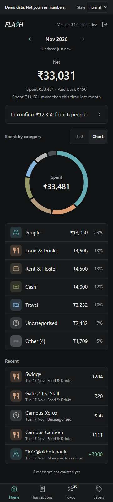
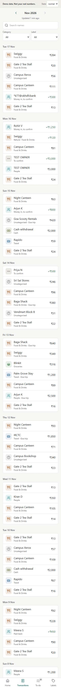
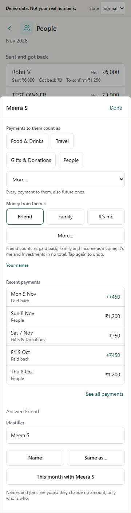
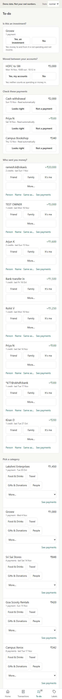

# Flash Expense Tracker

Personal expense tracker. It turns bank, card and UPI SMS alerts into clean
transactions, then categorises and analyses them, and checks itself against
the bank statement. Minimal UI, algorithm-heavy Python engine.

Status: Phase 4 done (21 Nov 2026), Phase 5 (the Android app) next. New here?
Start with [docs/OVERVIEW.md](docs/OVERVIEW.md), a one-page tour. Then
[NOTES.md](NOTES.md), [docs/PLAN.md](docs/PLAN.md) and the Phase 4 retro
[docs/retro/phase-4.md](docs/retro/phase-4.md).

## Screens

Demo data only (made-up names and amounts), 360 px wide. Every screen and
sheet, light, dark and at 200 % text: [docs/design/screens-4h.html](docs/design/screens-4h.html).

| Home | Home, chart (dark) | Transactions | Person sheet | To-do |
| --- | --- | --- | --- | --- |
|  |  |  |  |  |

## What it does

- **Reads SMS**: HDFC and SBI templates, a careful generic parser for other
  banks; every message stored with its parser version, so it can be read
  again when a parser improves.
- **Works out the month on the server**: Spent, Paid back and Net, where only
  what the owner confirmed lowers Net; categories from brands, keywords and
  payee names; transfers between the owner's own accounts.
- **Offline-first PWA**: the phone keeps a copy and opens at once; every tap
  is saved on the phone and sent through an outbox, once.
- **The owner decides**: To-do asks who sent money (Friend, Family, It's
  me…), which category a payee gets, whether two payments are a transfer;
  the engine only suggests.
- **Checks itself against the bank**: `statement-check` compares the HDFC
  statement with the app per month and names the likely cause of every gap;
  safe-to-paste output is counts and rupee sums only.

## Stack

- **backend/**: Python 3.12, FastAPI, SQLAlchemy 2, Alembic, pydantic-settings,
  pytest, ruff. Hosted on Render (free).
- **frontend/**: React, Vite, TypeScript, Tailwind CSS, installable PWA
  (vite-plugin-pwa). Hosted on Vercel.
- **Database**: SQLite locally, Supabase Postgres in production.

## Quick start (Windows PowerShell)

Needs Python 3.12 and Node 24. On macOS/Linux, use `.venv/bin/` in place of
`.venv\Scripts\`.

```powershell
# Backend: http://localhost:8000/health
cd backend
py -3.12 -m venv .venv          # or: uv venv --python 3.12 --seed .venv
.\.venv\Scripts\python.exe -m pip install -r requirements-dev.txt
Copy-Item .env.example .env
.\.venv\Scripts\python.exe -m uvicorn app.main:app --reload --port 8000

# Frontend: http://localhost:5173 (second terminal)
cd frontend
npm install
Copy-Item .env.example .env
npm run dev
```

Checks (the same ones CI runs):

```powershell
backend\.venv\Scripts\ruff.exe check . ; backend\.venv\Scripts\ruff.exe format --check .
cd backend; .\.venv\Scripts\python.exe -m pytest -q; cd ..
backend\.venv\Scripts\python.exe -m pytest -q scripts
cd frontend; npm run typecheck; npm run build
```

## Layout

```
backend/    FastAPI app, Alembic migrations, tests
frontend/   Vite React PWA
scripts/    redact_sms.py (makes a safe SMS sample from a backup)
infra/      render.yaml and hosting guide (Vercel, Render, Supabase, cron-job.org)
docs/       HANDOFF.md, PLAN.md, DECISIONS.md, engine and data-model guides
mobile/     Capacitor Android shell (later phase)
data/       gitignored; see data/README.md
```

Rules for contributors and agents are in [CLAUDE.md](CLAUDE.md).
